# คู่มือระบบจองคอร์ท Srichaphan Tennis Academy

ระบบจองคอร์ทเทนนิสของ **Srichaphan Tennis Academy** — **5 คอร์ท (C1–C5)** เปิด **06:00–23:00 ทุกวัน** จองเป็น **รายชั่วโมง**
จองแล้ว **ชำระเงินโดยโอนเข้าบัญชี + อัปโหลดสลิป** การจองจะสมบูรณ์เมื่อ **แอดมินกดยืนยันสลิป**

**ค่าคอร์ท**

| ช่วงเวลา | ราคา |
|---|---|
| ☀️ 06:00 – 18:00 | **฿250 / ชม.** |
| 🌙 18:00 – 23:00 (เปิดไฟ) | **฿350 / ชม.** |

**โอนเข้าบัญชี** ธนาคารกรุงศรีอยุธยา (กรุงศรี) · **173-1-30405-3** · ธนากร ศรีชาพันธุ์

**สิทธิ์ตามเลเวล**

| เลเวล | ดูตาราง + จองล่วงหน้า | จองได้สูงสุด/วัน | จองค้างได้ | ยกเลิกได้ถึง | สิทธิ์พิเศษ |
|---|---|---|---|---|---|
| 👑 **แอดมิน** (`admin`) | 30 วัน | ไม่จำกัด | ไม่จำกัด | ตลอด | ยืนยันสลิป · จองให้คนอื่น · ปิดคอร์ท · ยกเลิกของทุกคน · จัดการผู้ใช้ |
| 🟢 **สมาชิก** (`member`) | **14 วัน** | 2 ชม. | 4 รายการ | **3 ชม.** ก่อนเล่น | — |
| 🔵 **ผู้เล่นทั่วไป** (`user`) | **7 วัน** | 1 ชม. | 2 รายการ | **3 ชม.** ก่อนเล่น | — |
| ⚪ ยังไม่ล็อกอิน | 7 วัน (ดูอย่างเดียว) | — | — | — | — |

> ราคา เลขบัญชี และตัวเลขสิทธิ์ทุกช่อง **แก้ได้เองใน Google Sheet** (แท็บ Settings และ Roles) มีผลทันที ไม่ต้องแก้โค้ด

**สารบัญ**

1. [ระบบทำงานยังไง](#1-ระบบทำงานยังไง)
2. [ติดตั้งครั้งแรก (เจ้าของระบบ)](#2-ติดตั้งครั้งแรก-เจ้าของระบบ) — ทำครั้งเดียว ~20 นาที
3. [ตั้งแอดมินและเลเวลผู้ใช้](#3-ตั้งแอดมินและเลเวลผู้ใช้)
4. [ปรับราคา บัญชีรับเงิน และสิทธิ์ (แท็บ Settings / Roles)](#4-ปรับราคา-บัญชีรับเงิน-และสิทธิ์-แท็บ-settings--roles)
5. [คู่มือผู้เล่น](#5-คู่มือผู้เล่น) — ส่งต่อให้ผู้เล่นได้เลย
6. [คู่มือแอดมิน](#6-คู่มือแอดมิน) — ตรวจสลิป และงานประจำวัน
7. [แก้โค้ด / อัปเดตเวอร์ชัน](#7-แก้โค้ด--อัปเดตเวอร์ชัน)
8. [เช็คลิสต์ก่อนเปิดใช้จริง](#8-เช็คลิสต์ก่อนเปิดใช้จริง)
9. [ถ้าเจอปัญหา](#9-ถ้าเจอปัญหา)
10. [ภาคผนวก: คอลัมน์ในชีท](#10-ภาคผนวก-คอลัมน์ในชีท)

---

## 1. ระบบทำงานยังไง

```
 ผู้เล่น (มือถือ/คอม)                 Google (ฟรี)
┌──────────────────┐   ดูตาราง/จอง    ┌───────────────────────┐   อ่าน/เขียน  ┌──────────────────────┐
│  index.html      │ ───────────────▶ │ Apps Script Web App   │ ────────────▶ │ Google Sheet         │
│  (หน้าเว็บจอง)    │ ◀─────────────── │ (โค้ด .gs ในชีท)        │ ◀──────────── │ Users/Bookings/      │
└──────────────────┘   ส่งสลิป (รูป)   │ ตรวจสิทธิ์ทุกครั้ง      │               │ Roles/Settings       │
                                     └───────────┬───────────┘               └──────────────────────┘
                                                 │ เก็บรูปสลิป
                                                 ▼
                                      Google Drive: โฟลเดอร์ "Srichaphan Court Booking — สลิปโอนเงิน"
```

**ขั้นตอนการจอง 1 ครั้ง**

```
เลือกช่อง → ยืนยัน → [รอชำระเงิน] ──อัปโหลดสลิปภายใน 30 นาที──▶ [รอตรวจสลิป] ──แอดมินยืนยัน──▶ [ยืนยันแล้ว] ✅
                         │                                              │
                         └─ ไม่ส่งสลิปใน 30 นาที → [หมดเวลาชำระ]        └─ แอดมินปฏิเสธ → [สลิปไม่ผ่าน]
                            (ช่องว่าง ให้คนอื่นจองได้)                       (ช่องว่าง ให้คนอื่นจองได้)
```

- ระหว่าง **รอชำระ / รอตรวจสลิป** ช่องนั้นถูกกันไว้ คนอื่นจองซ้อนไม่ได้
- **กฎทุกข้อตรวจที่หลังบ้าน** (ราคา, จองล่วงหน้ากี่วัน, กี่ชั่วโมงต่อวัน ฯลฯ) — แก้หน้าเว็บในเครื่องตัวเองก็โกงไม่ได้
  ราคาคิดที่หลังบ้านตอนกดจอง ผู้เล่นแก้ยอดเองไม่ได้
- **กันจองชนกัน** — สองคนกดช่องเดียวกันพร้อมกัน คนแรกได้ คนที่สองได้ข้อความ "มีคนจองไปแล้ว"
- **ไม่ลบข้อมูล** — ยกเลิก/หมดเวลา/ปฏิเสธ แถวยังอยู่ในชีท แค่เปลี่ยนสถานะ ย้อนดูได้เสมอ
- **สลิป** เก็บใน Google Drive ของเจ้าของระบบ ดูได้เฉพาะเจ้าของการจองและแอดมิน (ไม่มีลิงก์สาธารณะ)
- **แอดมินจองเอง** (จองให้ลูกค้าที่โทรมา / ปิดคอร์ท) = ยืนยันทันที ไม่ต้องอัปโหลดสลิป
- **โหมดทดลอง** — ก่อนต่อหลังบ้าน หน้าเว็บขึ้นแถบเหลือง "โหมดทดลอง" รันระบบเดียวกันเป๊ะแต่เก็บข้อมูลใน browser เครื่องนั้น
  ลองได้ทั้งวงจร จอง → ส่งสลิป → ล็อกอินแอดมินกดยืนยัน
  (แอดมิน `0800000001 / admin123` · สมาชิก `0800000002 / member123` · ทั่วไป `0800000003 / user123`)

| ส่วน | ไฟล์ | อยู่ที่ไหน |
|---|---|---|
| หน้าเว็บจอง | `index.html` | GitHub Pages ของ repo `srichaphan-court-booking` |
| ระบบหลังบ้าน | `apps-script/Srichaphan_Court_Booking.gs` | Apps Script ที่ผูกกับ Google Sheet |
| ฐานข้อมูล | Google Sheet แท็บ **Users**, **Bookings**, **Roles**, **Settings** | Google Drive ของเจ้าของระบบ |
| รูปสลิป | โฟลเดอร์ "Srichaphan Court Booking — สลิปโอนเงิน" | Google Drive ของเจ้าของระบบ |

---

## 2. ติดตั้งครั้งแรก (เจ้าของระบบ)

**ต้องมี:** บัญชี Google ที่จะเป็นเจ้าของข้อมูลและรูปสลิป (แนะนำบัญชีกลางของสนาม)
และสิทธิ์แก้ไฟล์ใน repo `srichaphan-court-booking` บน GitHub

### ขั้นที่ 1 — สร้าง Google Sheet

1. ล็อกอิน Google ด้วยบัญชีเจ้าของระบบ → เปิด [sheets.new](https://sheets.new)
2. ตั้งชื่อชีท (มุมซ้ายบน "Untitled spreadsheet") เป็น **Srichaphan Court Booking**
3. ไม่ต้องพิมพ์อะไรในชีท — สคริปต์จะสร้างแท็บให้เอง

### ขั้นที่ 2 — วางโค้ด Apps Script

1. ในชีท กดเมนู **Extensions (ส่วนขยาย) → Apps Script** — จะเปิดแท็บใหม่ มีไฟล์ `Code.gs`
2. คลิกในช่องโค้ด → **Ctrl+A** (Mac: Cmd+A) → **Delete** ให้ว่างเปล่า
3. เปิดไฟล์ [`apps-script/Srichaphan_Court_Booking.gs`](../apps-script/Srichaphan_Court_Booking.gs) บน GitHub
   → กดไอคอน **Copy raw file** (สี่เหลี่ยมซ้อนกัน มุมขวาบนของกรอบโค้ด) → กลับมาวางในช่องโค้ด
4. ตั้งชื่อโปรเจกต์ (มุมซ้ายบน "Untitled project") เป็น **Srichaphan Court Booking**
5. กด **Ctrl+S** เพื่อบันทึก

### ขั้นที่ 3 — รัน `setup`

1. ดรอปดาวน์ข้างปุ่ม **▶ Run** → เลือก **`setup`**
   ⚠️ ต้องเป็น `setup` เท่านั้น ฟังก์ชันอื่นเป็นตัวช่วย รันเดี่ยว ๆ จะ error
2. กด **▶ Run** → หน้าต่าง **Authorization required** → **Review permissions** → เลือกบัญชี
3. ถ้าขึ้น **"Google hasn't verified this app"** (หน้าตาน่ากลัว แต่ปกติ)
   → กด **Advanced** (ข้อความเล็ก ๆ ด้านล่างซ้าย) → **Go to Srichaphan Court Booking (unsafe)**
   ❗ ปลอดภัย เพราะเป็นสคริปต์ของคุณเองที่เพิ่งวางเข้าไป
4. หน้าถัดไปบอกสิทธิ์ที่ขอ: **Google Sheets** (เก็บข้อมูลการจอง), **Google Drive** (เก็บรูปสลิป),
   เชื่อมต่อภายนอก (ให้หน้าเว็บเรียกได้) → กด **Allow**
   (ถ้ามีช่องให้ติ๊กเลือกสิทธิ์ทีละข้อ ให้ติ๊ก **Select all**)
5. ดูที่ **Execution log** ด้านล่าง ต้องขึ้น
   ```
   ✅ สร้างแท็บ Users · สร้างแท็บ Bookings · สร้างแท็บ Roles · สร้างแท็บ Settings
   📁 โฟลเดอร์เก็บสลิป: Srichaphan Court Booking — สลิปโอนเงิน
   ขั้นต่อไป: Deploy → New deployment → Web app
   Execution completed
   ```
6. กลับไปแท็บ Google Sheet → เห็นแท็บ **Users**, **Bookings**, **Roles**, **Settings**
   - **Roles** มี 3 แถว: `admin`, `member` (14 วัน), `user` (7 วัน)
   - **Settings** มีราคา 250 / 350, เลขบัญชีกรุงศรี, ชื่อบัญชี, เวลาชำระ 30 นาที
7. ใน Google Drive จะมีโฟลเดอร์ใหม่ **Srichaphan Court Booking — สลิปโอนเงิน** (ห้ามลบ)

> 💡 `setup` **รันซ้ำได้ปลอดภัย** — ไม่ลบไม่ทับข้อมูล แค่เติมแท็บ/คอลัมน์/ค่าที่ยังขาด

### ขั้นที่ 4 — Deploy เป็น Web App

1. หน้า Apps Script → ปุ่มสีฟ้ามุมขวาบน **Deploy → New deployment**
2. ข้าง "Select type" กดไอคอนเฟือง ⚙️ → เลือก **Web app**
3. กรอก

   | ช่อง | ใส่ |
   |---|---|
   | Description | `Srichaphan Court Booking v1` |
   | Execute as | **Me (อีเมลของคุณ)** |
   | Who has access | **Anyone** |

   ⚠️ **Who has access ต้องเป็น "Anyone"** — ไม่ใช่ "Anyone with Google account" และไม่ใช่ "Only myself"
   (ผู้เล่นไม่ต้องมีบัญชี Google — ระบบใช้เบอร์โทร + รหัสผ่านของตัวเอง)
4. กด **Deploy** (ถ้าขอ Authorize อีกรอบ ทำแบบขั้นที่ 3)
5. หน้าต่าง **New deployment** มี **Web app URL** → กด **Copy**
   หน้าตา: `https://script.google.com/macros/s/AKfycb.................../exec` (ต้องลงท้ายด้วย `/exec`)

### ขั้นที่ 5 — ทดสอบ URL

เปิด URL ที่ก๊อปมาในแท็บใหม่ ต้องเห็น

```json
{"ok":true,"service":"Srichaphan Tennis Academy Court Booking","clock":{"today":"2026-10-17","hour":13,"now":1792216320000}}
```

- เห็นแบบนี้ = หลังบ้านพร้อม ✅
- เห็นหน้าให้ล็อกอิน Google → Who has access ไม่ใช่ Anyone (แก้ที่ Deploy → Manage deployments)
- เห็น error "ยังไม่ได้รัน setup()" → กลับไปทำขั้นที่ 3

### ขั้นที่ 6 — ใส่ URL ในหน้าเว็บ

1. เปิด [หน้าแก้ไฟล์ index.html บน GitHub](https://github.com/woopssocialclub/srichaphan-court-booking/edit/main/index.html)
2. กด Ctrl+F หา `var API_URL` จะเจอ
   ```js
   var API_URL = '';
   ```
3. ใส่ URL ระหว่างเครื่องหมาย `'` `'`
   ```js
   var API_URL = 'https://script.google.com/macros/s/AKfycb.................../exec';
   ```
   ⚠️ อย่าลบเครื่องหมาย `'` และ `;`
4. กด **Commit changes...** → **Commit changes**

### ขั้นที่ 7 — ขึ้นเว็บจริง (GitHub Pages)

ถ้ายังไม่ได้เปิด GitHub Pages:

1. repo `srichaphan-court-booking` → **Settings** → เมนูซ้าย **Pages**
2. **Build and deployment** → Source: **Deploy from a branch** → Branch: **main** · **/ (root)** → **Save**
3. รอ 1–2 นาที → เว็บอยู่ที่ **https://woopssocialclub.github.io/srichaphan-court-booking/**

> อยากได้โดเมนของสนามเอง (เช่น `booking.srichaphan.com`) → ช่อง **Custom domain** ในหน้าเดียวกัน
> แล้วตั้ง DNS ที่ผู้ให้บริการโดเมน (CNAME ชี้ไปที่ `woopssocialclub.github.io`)

เปิดเว็บแล้ว **แถบเหลือง "โหมดทดลอง" ต้องหายไป** = ต่อหลังบ้านจริงสำเร็จ
ถ้ายังเห็น → `API_URL` ยังว่าง หรือ browser จำไฟล์เก่า (กด Ctrl+Shift+R)

---

## 3. ตั้งแอดมินและเลเวลผู้ใช้

### บัญชีแอดมินคนแรก

เปิดหน้าเว็บจอง → ไอคอนคนมุมขวาบน → แท็บ **สมัครสมาชิก** → กรอกเบอร์ ชื่อ รหัสผ่าน

**คนแรกที่สมัคร (ตอนที่ระบบยังไม่มีแอดมิน) จะได้เป็นแอดมินอัตโนมัติ**
⚠️ สมัครทันทีหลังขึ้นเว็บ **ก่อนแชร์ลิงก์ให้คนอื่น** แล้วเช็คในแท็บ Users ว่าแถวของคุณ `role` = `admin`

หลังจากนั้นทุกคนที่สมัครจะเริ่มที่ **ผู้เล่นทั่วไป** (`user`)

### เปลี่ยนเลเวลผู้ใช้ (เช่น ตั้งเป็นสมาชิก)

**ทาง A — ในหน้าเว็บ (แนะนำ):** ล็อกอินแอดมิน → แท็บ **แอดมิน** → เลื่อนลงไปส่วน **ผู้ใช้ทั้งหมด**
→ ค้นชื่อ/เบอร์ → ดรอปดาวน์ด้านขวาเลือก **สมาชิก** → ขึ้น "อัปเดตแล้ว" มีผลทันที

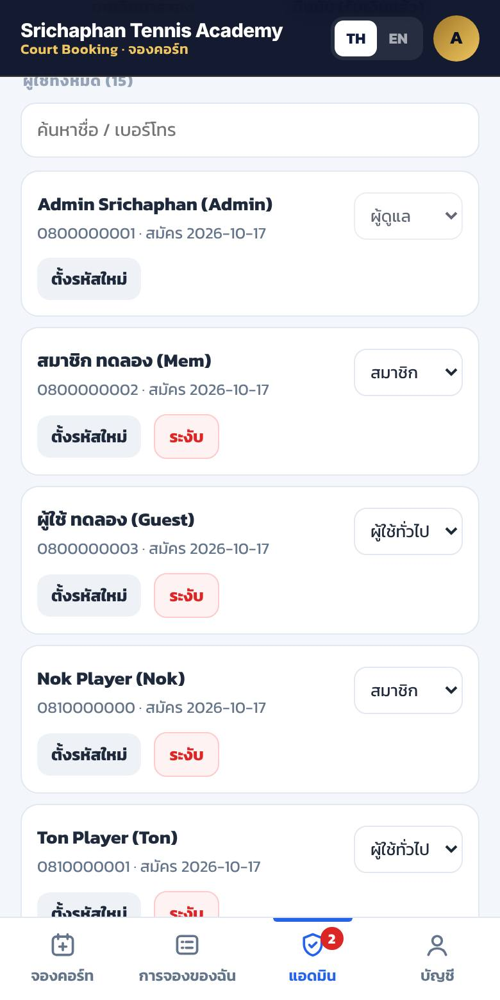

**ทาง B — ในชีท:** แท็บ **Users** → คอลัมน์ `role` → พิมพ์ `member` / `user` / `admin` (ตัวพิมพ์เล็ก)

> เพิ่มแอดมินคนที่ 2 ไว้เสมอ (เช่น ผู้จัดการสนาม) เผื่อแอดมินหลักลืมรหัส หรือไม่ว่างตรวจสลิป

---

## 4. ปรับราคา บัญชีรับเงิน และสิทธิ์ (แท็บ Settings / Roles)

แก้ในชีทได้เลย **มีผลทันที ไม่ต้อง deploy ใหม่** (ผู้ใช้ที่เปิดหน้าเว็บค้างไว้ รีเฟรช 1 ครั้ง)

### แท็บ Settings — ราคา / บัญชี / เวลาชำระ

| key | ค่าตอนนี้ | ความหมาย |
|---|---|---|
| `price_day` | 250 | ราคาต่อชั่วโมง ช่วงกลางวัน (บาท) |
| `price_night` | 350 | ราคาต่อชั่วโมง ช่วงเปิดไฟ (บาท) |
| `lights_from_hour` | 18 | เริ่มคิดราคาเปิดไฟตั้งแต่ช่องนี้ (18 = ช่อง 18:00–19:00 เป็นต้นไป) |
| `pay_within_minutes` | 30 | ต้องอัปโหลดสลิปภายในกี่นาทีหลังกดจอง ไม่งั้นการจองหลุด |
| `bank_name` | ธนาคารกรุงศรีอยุธยา (กรุงศรี) | ชื่อธนาคารที่แสดงในหน้าชำระเงิน |
| `bank_account_no` | 1731304053 | เลขบัญชี (ตัวเลขล้วน หน้าเว็บจะแสดงเป็น 173-1-30405-3) |
| `bank_account_name` | ธนากร ศรีชาพันธุ์ | ชื่อบัญชี |

> แก้เฉพาะคอลัมน์ `value` · อย่าแก้คอลัมน์ `key`
> ราคาใหม่มีผลกับการจองที่ทำหลังจากแก้ — การจองเดิมเก็บราคาตอนจองไว้แล้ว ไม่เปลี่ยนตาม

### แท็บ Roles — สิทธิ์แต่ละเลเวล

| คอลัมน์ | ความหมาย | admin / member / user |
|---|---|---|
| `role` | รหัสเลเวล — **ห้ามแก้ชื่อเลเวลที่มีคนใช้อยู่** | `admin` / `member` / `user` |
| `label` | ชื่อที่แสดง รูปแบบ `ไทย / English` | ผู้ดูแล / สมาชิก / ผู้ใช้ทั่วไป |
| `advance_days` | **ดูตาราง + จองล่วงหน้าได้กี่วัน** (0 = วันนี้อย่างเดียว) | 30 / **14** / **7** |
| `max_hours_per_day` | จองได้กี่ชั่วโมงต่อวัน (รวมทุกคอร์ท) · 0 = ไม่จำกัด | 0 / 2 / 1 |
| `max_active_bookings` | มีการจองที่ยังไม่ถึงเวลาเล่นค้างได้กี่ช่อง · 0 = ไม่จำกัด | 0 / 4 / 2 |
| `cancel_before_hours` | **ยกเลิกได้ถึงกี่ชั่วโมงก่อนเวลาเล่น** (ใช้กับการจองที่ชำระแล้ว) | 0 / **3** / **3** |
| `can_book_for_others` | ใส่ชื่อคนอื่นตอนจองได้ | TRUE / FALSE / FALSE |
| `can_block` | ปิดคอร์ทได้ + เลือกดูวันไหนก็ได้ | TRUE / FALSE / FALSE |
| `can_cancel_any` | ยกเลิกของทุกคน + เห็นชื่อผู้จองในตาราง | TRUE / FALSE / FALSE |
| `can_manage_users` | จัดการผู้ใช้ในแท็บแอดมิน | TRUE / FALSE / FALSE |
| `can_confirm_payments` | **ตรวจ/ยืนยันสลิป** · การจองของคนที่มีสิทธิ์นี้ยืนยันทันทีไม่ต้องจ่ายผ่านระบบ | TRUE / FALSE / FALSE |

**ตัวอย่าง**

- อยากมีพนักงานหน้าเคาน์เตอร์ที่ตรวจสลิปได้แต่จัดการผู้ใช้ไม่ได้ → เพิ่มแถว `staff` · `พนักงาน / Staff` · `30` · `0` · `0` · `0` · `TRUE` · `FALSE` · `FALSE` · `FALSE` · `TRUE`
- อยากให้ผู้เล่นทั่วไปจองได้ 2 ชม./วัน → แถว `user` คอลัมน์ `max_hours_per_day` = `2`

⚠️ **ห้ามลบแถว `user`** — ระบบใช้กับคนที่ยังไม่ล็อกอิน และผู้ใช้ที่ role สะกดผิด
⚠️ **ห้ามเปลี่ยนชื่อหัวคอลัมน์** (แถวที่ 1) ในทุกแท็บ

---

## 5. คู่มือผู้เล่น

> ส่วนนี้ก๊อปไปโพสต์ใน LINE / กลุ่มได้เลย

### สมัครและล็อกอิน

1. เปิดเว็บจองคอร์ท **https://woopssocialclub.github.io/srichaphan-court-booking/**
2. กดไอคอนคนมุมขวาบน → แท็บ **สมัครสมาชิก**
3. กรอกเบอร์โทร, ชื่อ-นามสกุล, ชื่อเล่น (ไม่บังคับ), รหัสผ่านอย่างน้อย 6 ตัว → **สมัครสมาชิก**
4. ครั้งต่อไปใช้เบอร์ + รหัสผ่าน **เข้าสู่ระบบ** (ระบบจำไว้ 30 วัน)

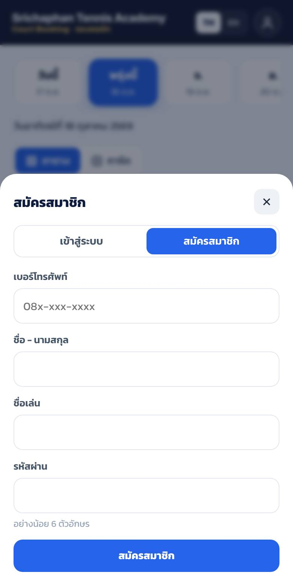 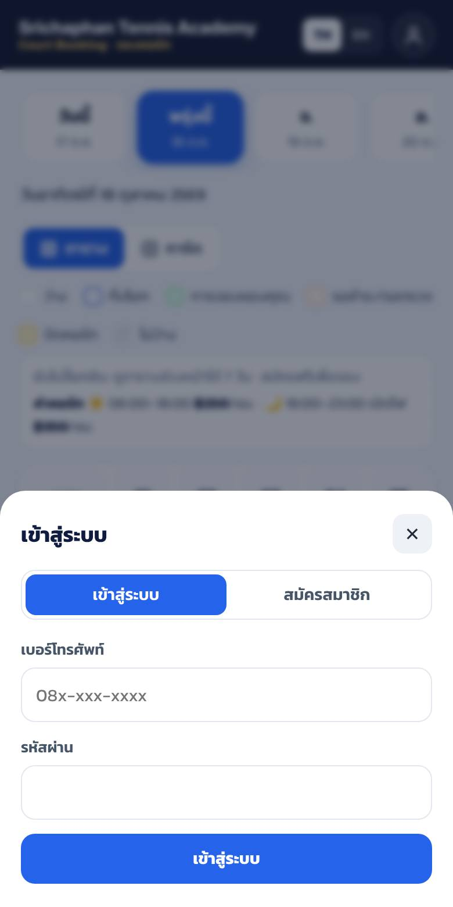

### ดูตารางสนามและราคา

- แถบวันด้านบนเลื่อนซ้าย-ขวาได้ — จำนวนวันขึ้นกับเลเวล: ผู้เล่นทั่วไป 7 วัน · สมาชิก 14 วัน
- กรอบเส้นประใต้ตารางบอก **ค่าคอร์ท**: ☀️ ก่อน 18:00 ฿250/ชม. · 🌙 18:00 เป็นต้นไป (เปิดไฟ) ฿350/ชม.
- ความหมายของสี

| สี | ความหมาย |
|---|---|
| ⬜ ขาว | ว่าง จองได้ |
| 🟦 กรอบฟ้า + ✓ + ราคา | ช่องที่คุณกำลังเลือก |
| 🟩 เขียว "คุณ" | การจองของคุณ (ยืนยันแล้ว) |
| 🟧 ส้มเส้นประ "รอชำระ / รอตรวจ" | การจองของคุณที่ยังไม่ได้ยืนยัน |
| 🟨 เหลือง | แอดมินปิดคอร์ท |
| ▨ เทาลาย 🔒 | มีคนจองแล้ว |

- กด **การ์ด** เพื่อดูรายชั่วโมง พร้อมราคาและจำนวนคอร์ทว่าง

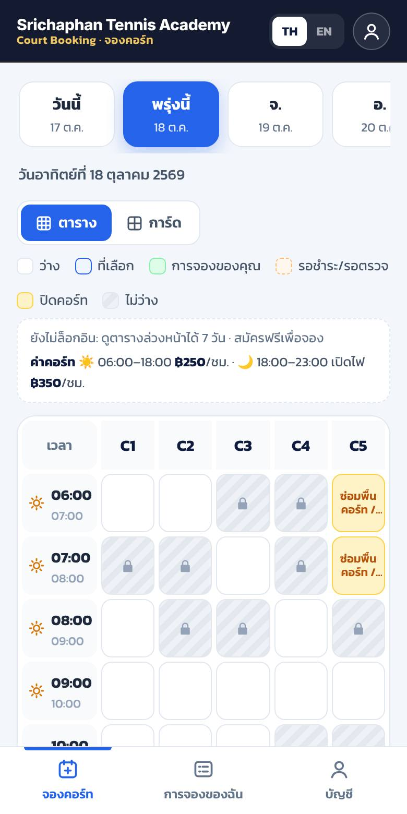 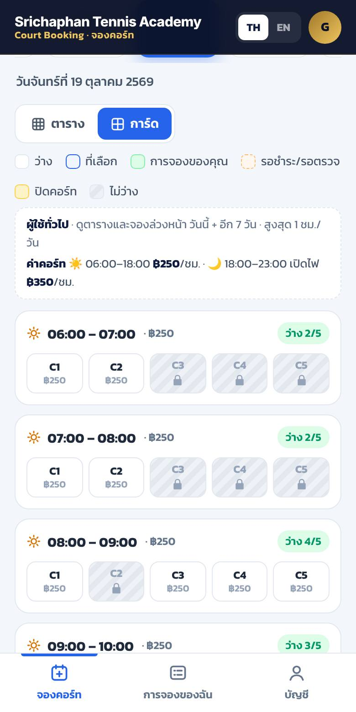

### จองและชำระเงิน

1. เลือกวัน → แตะช่องว่างที่ต้องการ (เลือกหลายช่องได้ตามโควต้าเลเวล) — ช่องจะขึ้น ✓ พร้อมราคา
   แถบด้านล่างบอก "เลือกแล้ว N ชั่วโมง · **รวม ฿...**" → กด **จองเลย**
2. ตรวจรายการและ **ยอดรวม** → กด **ยืนยัน**
3. ขึ้นหน้า **ชำระเงิน** บอกยอดที่ต้องโอน + บัญชีกรุงศรี (กด **คัดลอก** เลขบัญชีไปวางในแอปธนาคารได้)
   และเวลาที่ต้องส่งสลิป (**ภายใน 30 นาที**)
4. โอนเงินในแอปธนาคาร → กลับมาแตะกรอบ **📎 แตะเพื่อเลือกรูปสลิป** → เลือกรูปสลิป → **ส่งสลิป**
5. สถานะเปลี่ยนเป็น **รอตรวจสลิป** → เมื่อแอดมินยืนยัน สถานะเป็น **ยืนยันแล้ว ✅** = จองสำเร็จ

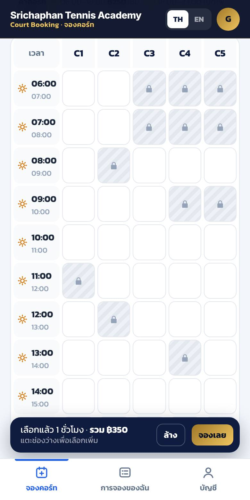 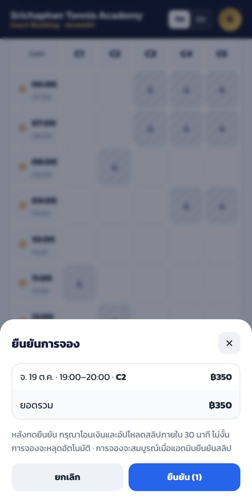 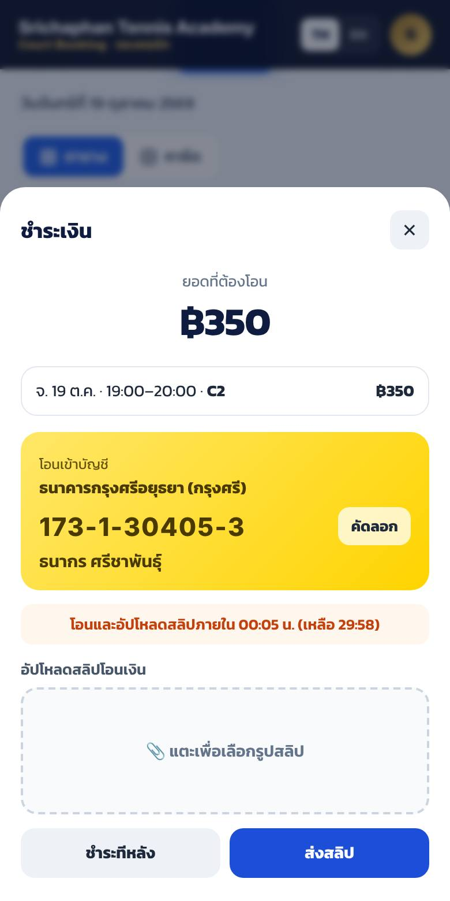 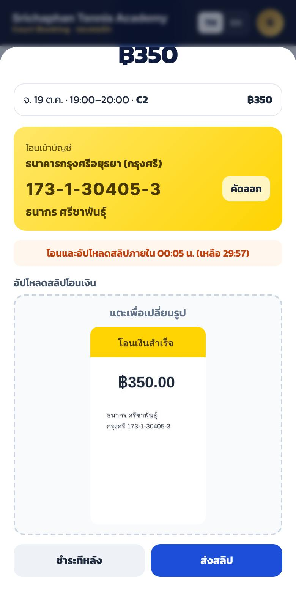

⚠️ **ไม่ส่งสลิปภายใน 30 นาที การจองจะหลุดอัตโนมัติ** ช่องกลับเป็นว่าง ต้องจองใหม่
(ถ้าโอนไปแล้วแต่ส่งไม่ทัน ติดต่อแอดมิน)
💡 ยังไม่สะดวกโอนตอนนั้น กด **ชำระทีหลัง** ได้ แล้วเข้าแท็บ **การจองของฉัน** → **ชำระเงิน / ส่งสลิป** ภายใน 30 นาที

ถ้าจองไม่ได้ ระบบจะบอกเหตุผล เช่น
"เลเวลของคุณดูตารางและจองล่วงหน้าได้ไม่เกิน 7 วัน" · "สิทธิ์ของคุณจองได้สูงสุด 1 ชม. ต่อวัน" · "C2 เวลา 18:00 มีคนจองไปแล้ว"

### การจองของฉัน / ยกเลิก

แท็บ **การจองของฉัน** แสดงการจองเป็นรายการ พร้อมสถานะและยอดเงิน

| สถานะ | ความหมาย | ทำอะไรได้ |
|---|---|---|
| 🟧 รอชำระเงิน | ยังไม่ได้ส่งสลิป | **ชำระเงิน / ส่งสลิป** · **ยกเลิกการจอง** (ยกเลิกได้ทันที) |
| 🔵 รอตรวจสลิป | ส่งสลิปแล้ว รอแอดมิน | **ดูสลิป** · **ส่งสลิปใหม่** (ถ้าส่งผิดรูป) |
| 🟩 ยืนยันแล้ว | จองสำเร็จ | ยกเลิกได้ (✕) ถ้าเหลือเวลาก่อนเล่น **อย่างน้อย 3 ชั่วโมง** |
| 🔴 สลิปไม่ผ่าน | แอดมินปฏิเสธ (มีเหตุผลแจ้ง) | ช่องถูกปล่อยแล้ว ต้องจองใหม่ |
| 🔴 หมดเวลาชำระ | ไม่ส่งสลิปใน 30 นาที | ช่องถูกปล่อยแล้ว ต้องจองใหม่ |

- **ยกเลิกการจองที่ชำระแล้ว ต้องติดต่อแอดมินเรื่องคืนเงิน** (ระบบไม่คืนเงินอัตโนมัติ)
- เหลือน้อยกว่า 3 ชั่วโมงก่อนเล่น → ยกเลิกเองไม่ได้ ติดต่อแอดมิน

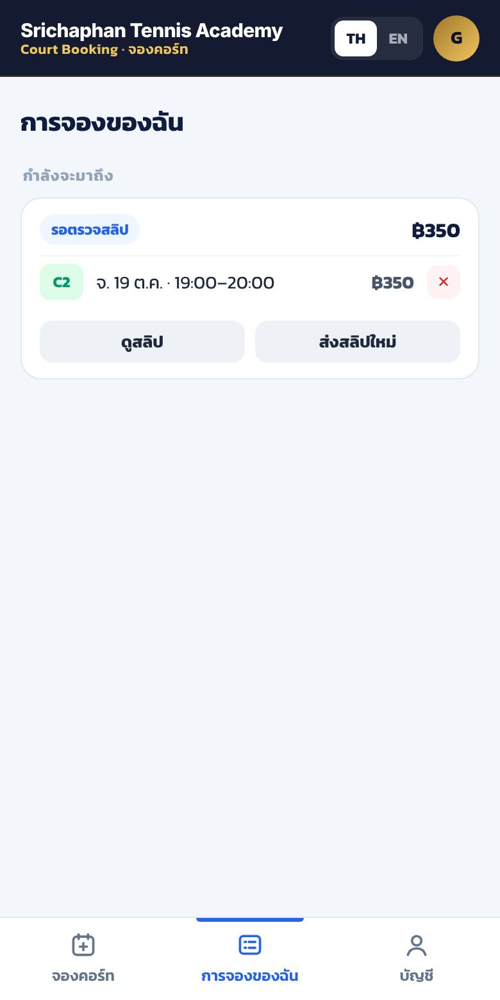 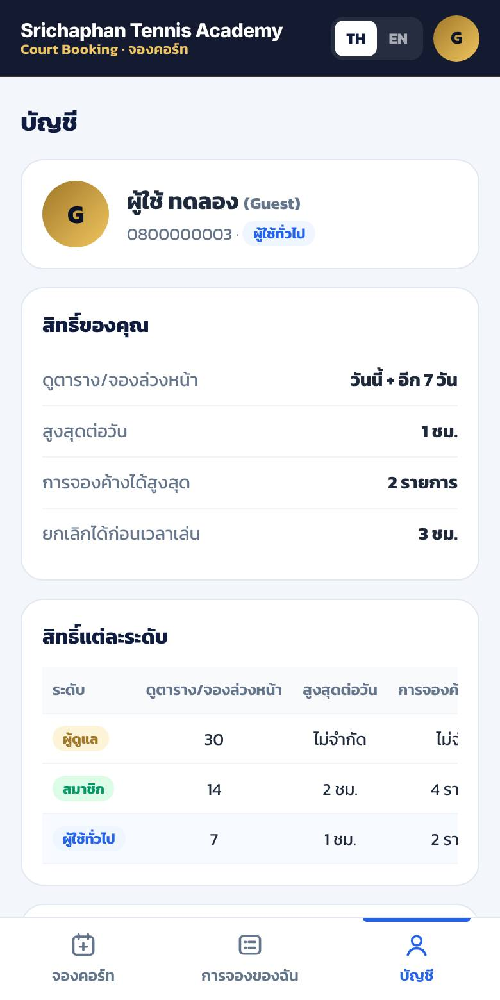

### บัญชี

แท็บ **บัญชี** → ดูเลเวลและสิทธิ์ของตัวเอง, **เปลี่ยนรหัสผ่าน**, **ออกจากระบบ** · ปุ่ม **TH / EN** มุมขวาบนสลับภาษา
**ลืมรหัสผ่าน** → ติดต่อแอดมินให้ตั้งรหัสใหม่

---

## 6. คู่มือแอดมิน

แอดมินเห็นทุกอย่างเหมือนผู้เล่น บวกกับ
- แถบวัน **30 วัน** + ช่อง **วันอื่น** เลือกวันไหนก็ได้ (ล่วงหน้าถึง 1 ปี)
- ตารางแสดง **ชื่อผู้จองทุกช่อง** (ช่องเส้นประ = ยังไม่ได้ยืนยัน)
- แท็บ **แอดมิน** ที่แถบล่าง — **เลขสีแดงบนไอคอน = จำนวนสลิปที่รอตรวจ**

### ✅ ตรวจสลิป (งานหลักทุกวัน)

แท็บ **แอดมิน** → ส่วน **รอตรวจสลิป**
แต่ละรายการบอก ชื่อ · เบอร์ (กดโทรได้) · คอร์ท/วัน/เวลา · **ยอดที่ต้องได้รับ**

1. กด **ดูสลิป** → ตรวจในแอปธนาคารของบัญชีกรุงศรีว่าเงินเข้าจริง:
   **ยอดตรง** · **ชื่อผู้รับ ธนากร ศรีชาพันธุ์** · **วันเวลาโอนหลังเวลาจอง** · ไม่ใช่สลิปเก่าที่เคยใช้
2. ถูกต้อง → **ยืนยันสลิป** → ผู้เล่นเห็นสถานะ **ยืนยันแล้ว** ทันที
3. ไม่ถูกต้อง → **ปฏิเสธ** → พิมพ์เหตุผล (เช่น "ยอดไม่ตรง" / "ไม่พบยอดเงินเข้า")
   → ผู้เล่นเห็นเหตุผล และ **ช่องว่างให้คนอื่นจองทันที**

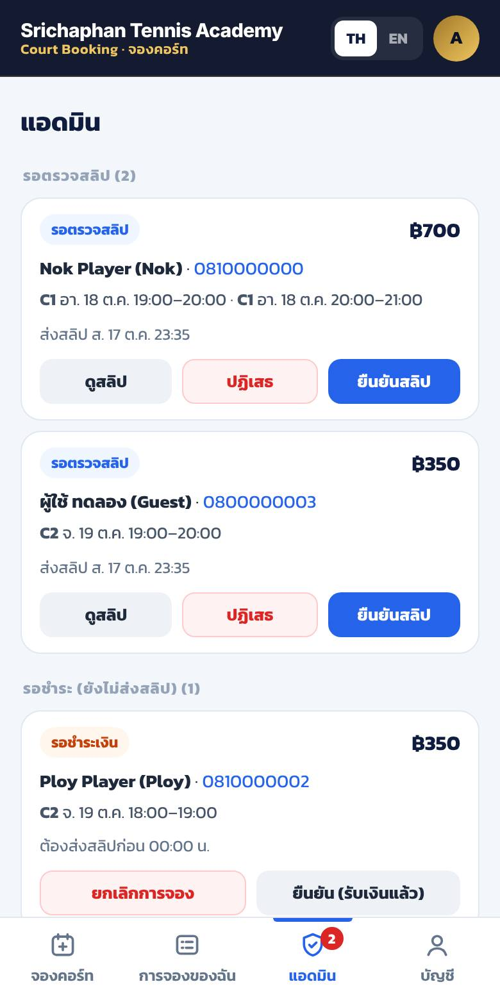 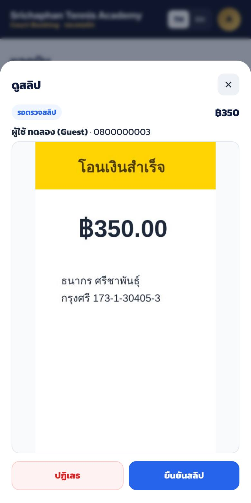

> ⚠️ **อย่ายืนยันจากรูปสลิปอย่างเดียว** — สลิปปลอมทำได้ง่าย ให้เช็คยอดเงินเข้าในแอปธนาคารทุกครั้ง

### รอชำระ (ยังไม่ส่งสลิป)

ส่วน **รอชำระ** แสดงการจองที่ยังไม่ส่งสลิป และเวลาที่จะหมดอายุ
- ปล่อยไว้ได้ — ไม่ส่งสลิปในเวลา ระบบปล่อยช่องเอง
- ลูกค้าจ่ายเงินสด / ส่งสลิปทาง LINE แทน → กด **ยืนยัน (รับเงินแล้ว)**
- อยากปล่อยช่องเลย → **ยกเลิกการจอง**

### จองให้ผู้เล่น (ลูกค้าโทรมา / จองให้โค้ช)

เลือกช่อง → **จองเลย** → ใส่ **จองให้ (ชื่อผู้เล่น)** เช่น `คุณสมชาย (โทรจอง)` → **หมายเหตุ** (ไม่บังคับ) → **ยืนยัน**
การจองของแอดมิน **ยืนยันทันที** ไม่ต้องส่งสลิป — เก็บเงินหน้าเคาน์เตอร์ (ราคาถูกบันทึกไว้ในชีทตามช่วงเวลา)

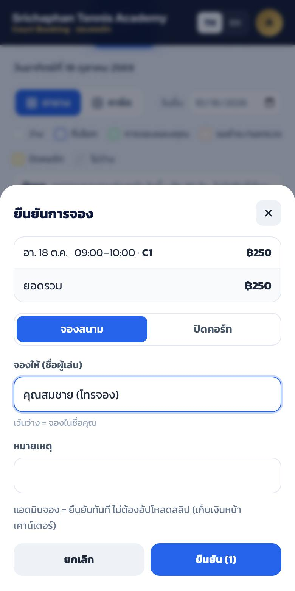

### ปิดคอร์ท (ซ่อม / คลาสเรียน / จัดแข่ง)

เลือกช่อง (ครั้งละไม่เกิน 20 ช่อง) → **จองเลย** → เลือก **ปิดคอร์ท** → ใส่ **เหตุผลที่ปิด** (ผู้เล่นเห็นในช่องสีเหลือง) → **ยืนยัน**
ปิดวันไกล ๆ (เช่น วันแข่งเดือนหน้า) ใช้ช่อง **วันอื่น**

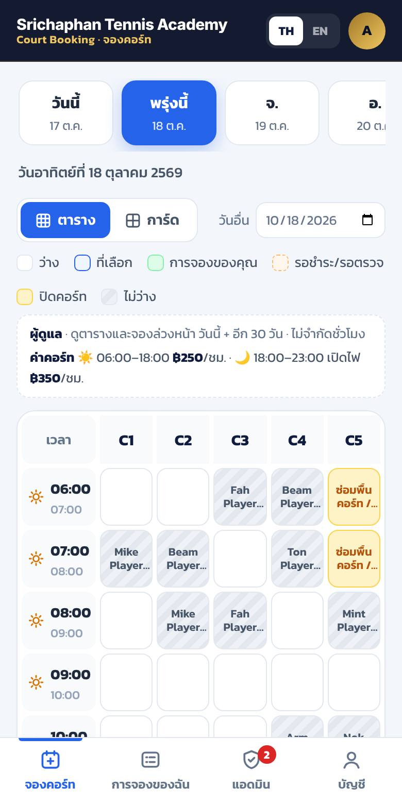 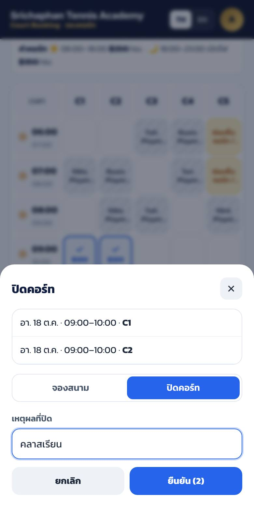

### ยกเลิกการจองของผู้เล่น / เปิดคอร์ทคืน

แตะช่องที่มีชื่อ (หรือช่องเหลือง) → ดูรายละเอียด (สถานะ, ราคา) → **ยกเลิกการจองนี้** / **เปิดคอร์ท**
แอดมินยกเลิกได้ตลอด — ถ้าผู้เล่นจ่ายแล้ว **คืนเงินเองนอกระบบ**

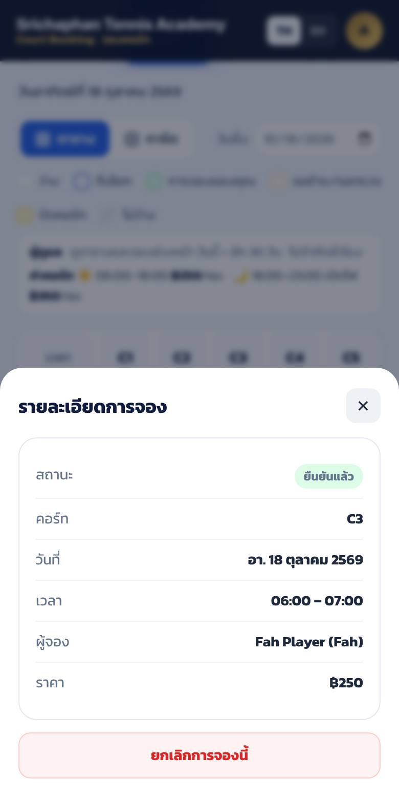

### จัดการผู้ใช้

แท็บ **แอดมิน** → ส่วน **ผู้ใช้ทั้งหมด**

| ทำอะไร | วิธี |
|---|---|
| เปลี่ยนเลเวล | ดรอปดาวน์ด้านขวาของชื่อ |
| ผู้ใช้ลืมรหัส | **ตั้งรหัสใหม่** → พิมพ์รหัสใหม่ (≥ 6 ตัว) → แจ้งผู้ใช้ |
| ระงับบัญชี (เช่น ส่งสลิปปลอม / จองแล้วไม่มาบ่อย) | **ระงับ** → ล็อกอินไม่ได้ทันที |
| เปิดบัญชีคืน | **เปิดใช้** |

### ดูข้อมูลในชีท / สรุปรายได้

แท็บ **Bookings** มีทุกช่องที่จอง พร้อม `price` และ `status`
- ยอดที่ได้รับจริง = รวม `price` ของแถว `status` = `confirmed` และ `type` = `booking`
  (ใช้ **Data → Create a filter** กรองช่วงวันที่ หรือใช้สูตร `=SUMIFS(I:I, J:J, "confirmed", H:H, "booking")` ตามตำแหน่งคอลัมน์จริง)
- อยากยกเลิกจากชีท → แก้ `status` เป็น `cancelled` (**อย่าลบแถว**)
- รูปสลิปทั้งหมดอยู่ในโฟลเดอร์ Drive **Srichaphan Court Booking — สลิปโอนเงิน** ชื่อไฟล์ขึ้นต้นด้วยรหัสการจอง (`order_id`)

---

## 7. แก้โค้ด / อัปเดตเวอร์ชัน

ค่าในบล็อก **"แก้ตรงนี้ได้"** ด้านบนของ `Srichaphan_Court_Booking.gs`

| ค่า | คุมอะไร | ตอนนี้ |
|---|---|---|
| `COURTS` | ชื่อ/จำนวนคอร์ท | `['C1','C2','C3','C4','C5']` |
| `OPEN_HOUR` / `CLOSE_HOUR` | เวลาเปิด–ปิด | `6` / `23` |
| `SESSION_DAYS` | ล็อกอินค้างได้กี่วัน | `30` |
| `MAX_BLOCK_DAYS_AHEAD` | แอดมินปิดคอร์ทล่วงหน้าไกลสุดกี่วัน | `365` |
| `MAX_SLIP_BYTES` | ขนาดรูปสลิปสูงสุด | 5 MB (หน้าเว็บย่อรูปให้ก่อนส่งอยู่แล้ว) |

> ราคา บัญชี เวลาชำระ และสิทธิ์เลเวล **ไม่ต้องแก้ในโค้ด** — แก้ในแท็บ Settings / Roles (ส่วนที่ 4)

### ⚠️ แก้โค้ด .gs แล้วต้อง deploy เวอร์ชันใหม่

1. วางโค้ดใหม่ทับใน Apps Script → Ctrl+S
2. เลือก **`setup`** → **▶ Run** (เติมแท็บ/คอลัมน์ใหม่ และขอสิทธิ์ใหม่ถ้ามี — ไม่ลบข้อมูลเดิม)
3. **Deploy → Manage deployments** → เลือก deployment เดิม → ไอคอนดินสอ ✏️ **Edit**
4. ช่อง **Version** เลือก **New version** → **Deploy**
5. URL เดิมใช้ต่อได้ ไม่ต้องแก้ `index.html`

❌ อย่ากด **New deployment** — จะได้ URL ใหม่ ต้องกลับไปแก้ `API_URL` ใน `index.html` ใหม่

### อัปเดตจากเวอร์ชันก่อนหน้า (ที่ยังไม่มีระบบชำระเงิน)

ทำตาม 5 ขั้นด้านบน — `setup` จะ
- สร้างแท็บ **Settings** (ราคา + บัญชีกรุงศรี) และโฟลเดอร์ Drive เก็บสลิป
- เพิ่มคอลัมน์ใหม่ในแท็บ **Bookings** (ต่อท้ายขวาสุด) — การจองเดิมถือว่า **ยืนยันแล้ว**
- เพิ่มคอลัมน์ `can_confirm_payments` ในแท็บ **Roles** และเปิดให้ทุกเลเวลที่จัดการผู้ใช้ได้
- **ไม่เปลี่ยนตัวเลขสิทธิ์เดิม** → ถ้าต้องการให้ผู้เล่นทั่วไปยกเลิกได้ถึง 3 ชม. แก้แถว `user` คอลัมน์ `cancel_before_hours` = `3` เอง

---

## 8. เช็คลิสต์ก่อนเปิดใช้จริง

- [ ] รัน `setup` แล้วเห็นแท็บ Users / Bookings / Roles / Settings และโฟลเดอร์สลิปใน Drive
- [ ] แท็บ **Settings**: ราคา 250 / 350, เลขบัญชี 1731304053, ชื่อ ธนากร ศรีชาพันธุ์ ถูกต้อง
- [ ] แท็บ **Roles**: `member` 14 วัน · `user` 7 วัน · ยกเลิกก่อน 3 ชม. ทั้งคู่
- [ ] Deploy: **Execute as: Me** + **Who has access: Anyone** → เปิด URL เห็น `{"ok":true,...}`
- [ ] ใส่ `API_URL` + เปิด GitHub Pages → **แถบเหลือง "โหมดทดลอง" หายไป**
- [ ] สมัครแอดมินตัวเองเป็นคนแรก → แท็บ Users role = `admin` · เพิ่มแอดมินสำรอง 1 คน
- [ ] ทดสอบด้วยมือถือ 2 เครื่อง
  - [ ] เครื่อง A สมัครผู้เล่นใหม่ → เห็น **8 วัน** → จอง 1 ช่องหลัง 18:00 → ยอดต้องเป็น **฿350**
  - [ ] หน้าชำระเงินแสดงบัญชีกรุงศรีถูกต้อง → โอนจริง ฿350 (หรือใช้รูปทดสอบ) → ส่งสลิป → สถานะ **รอตรวจสลิป**
  - [ ] เครื่อง B (แอดมิน) เห็นเลขแดงบนแท็บแอดมิน → ดูสลิป → **ยืนยันสลิป** → เครื่อง A เห็น **ยืนยันแล้ว**
  - [ ] ในชีท Bookings แถวนั้น status = `confirmed` · ใน Drive มีรูปสลิป
  - [ ] จองอีกช่องแล้ว **ไม่ส่งสลิป** รอ 30 นาที → ช่องกลับเป็นว่าง สถานะ **หมดเวลาชำระ**
  - [ ] แอดมินลอง **ปฏิเสธ** สลิป 1 ครั้ง → ผู้เล่นเห็นเหตุผล ช่องว่าง
  - [ ] แอดมินเปลี่ยนเครื่อง A เป็นสมาชิก → รีเฟรช → เห็น **15 วัน**
- [ ] แอดมินลองปิดคอร์ท 1 ช่อง แล้วเปิดคืน
- [ ] โพสต์ประกาศให้ผู้เล่น (ใช้ส่วนที่ 5)

---

## 9. ถ้าเจอปัญหา

| อาการ | สาเหตุ / วิธีแก้ |
|---|---|
| หน้าเว็บขึ้น "เชื่อมต่อไม่ได้" | `API_URL` ผิด (ต้องลงท้าย `/exec`) หรือ deployment ไม่ใช่ *Anyone* |
| ยังเห็นแถบเหลือง "โหมดทดลอง" | `API_URL` ยังว่าง หรือ browser จำไฟล์เก่า → Ctrl+Shift+R |
| ส่งสลิปแล้วขึ้น "เกิดข้อผิดพลาด" / error เรื่อง Drive | ยังไม่ได้อนุญาตสิทธิ์ Google Drive → รัน `setup` ใน Apps Script แล้วกด Allow → deploy **New version** |
| ส่งสลิปขึ้น "หมดเวลาชำระแล้ว" | เกิน 30 นาที การจองหลุดแล้ว → จองใหม่ (ถ้าโอนแล้ว แอดมินจองให้ด้วยชื่อผู้เล่นแทน) |
| ส่งสลิปขึ้น "ไฟล์สลิปต้องเป็นรูปภาพ" | ไฟล์ไม่ใช่รูป หรือ browser อ่านรูปไม่ได้ (เช่น HEIC บน Chrome คอม) → แคปหน้าจอสลิปแล้วส่งรูปแคปแทน |
| ผู้เล่นบอกยอดไม่ตรงกับที่คิดไว้ | ราคาคิดตามช่วงเวลา: ช่องที่เริ่ม 18:00 ขึ้นไป ฿350 · ก่อนนั้น ฿250 (แก้ได้ในแท็บ Settings) |
| แก้ Settings / Roles แล้วหน้าเว็บยังเหมือนเดิม | ผู้ใช้ต้องรีเฟรชหน้าเว็บ 1 ครั้ง |
| แก้โค้ด .gs แล้วไม่เปลี่ยน | ยังไม่ได้ deploy **New version** (ส่วนที่ 7) |
| error "ยังไม่ได้รัน setup()" | รัน `setup` ใน Apps Script (รันซ้ำได้ ไม่ลบข้อมูล) |
| "ระบบกำลังยุ่ง ลองใหม่อีกครั้ง" | มีคนจองพร้อมกันเยอะมากในวินาทีเดียว → กดใหม่ |
| ผู้ใช้ลืมรหัสผ่าน | แอดมิน → แท็บแอดมิน → **ตั้งรหัสใหม่** |
| แอดมินลืมรหัสตัวเอง | ใช้แอดมินสำรองตั้งให้ · หรือในชีทแท็บ Users เปลี่ยน role บัญชีอื่นที่คุณใช้ได้เป็น `admin` |
| เผลอลบโฟลเดอร์สลิปใน Drive | กู้จากถังขยะ Drive · ถ้ากู้ไม่ได้ ระบบสร้างโฟลเดอร์ใหม่เองตอนส่งสลิปครั้งถัดไป (สลิปเก่าหาย) |
| ระบบเริ่มช้า (Bookings หลายหมื่นแถว) | ย้ายแถวเก่าที่เลยวันเล่นไปแล้วไปเก็บชีทอื่น (เก็บแถวหัวไว้ · อย่าย้ายการจองที่ยังไม่ถึงวัน) |

---

## 10. ภาคผนวก: คอลัมน์ในชีท

**Users**

| คอลัมน์ | ความหมาย | แก้มือได้? |
|---|---|---|
| `id` | รหัสผู้ใช้ | ❌ |
| `phone` | เบอร์โทร ใช้ล็อกอิน | ⚠️ ได้ ถ้าผู้ใช้เปลี่ยนเบอร์ (ห้ามซ้ำ) |
| `name`, `nickname` | ชื่อ / ชื่อเล่น | ✅ |
| `role` | เลเวล — ต้องตรงกับแท็บ Roles | ✅ |
| `status` | `active` / `suspended` | ✅ |
| `salt`, `password_hash` | รหัสผ่านแบบเข้ารหัส (ไม่มีใครอ่านรหัสจริงได้) | ❌ ห้ามแตะ |
| `created_at` | วันที่สมัคร | ❌ |

**Bookings** (1 แถว = 1 คอร์ท 1 ชั่วโมง)

| คอลัมน์ | ความหมาย |
|---|---|
| `id` | รหัสช่องที่จอง |
| `order_id` | รหัสการจอง — ช่องที่จองพร้อมกันในครั้งเดียวมี `order_id` เดียวกัน ชำระ/ส่งสลิป/ยืนยันพร้อมกัน |
| `date`, `hour`, `court` | วันที่ (`2026-10-18`), ชั่วโมงเริ่ม (`18` = 18:00–19:00), คอร์ท |
| `user_id`, `name` | ใครกดจอง / ชื่อที่แสดง (แอดมินจองให้ = ชื่อที่ใส่) |
| `type` | `booking` = จองเล่น · `block` = แอดมินปิดคอร์ท |
| `price` | ราคาของช่องนี้ ณ ตอนจอง (ปิดคอร์ท = 0) |
| `status` | `pending_payment` รอชำระ · `pending_review` รอตรวจสลิป · `confirmed` ยืนยันแล้ว · `rejected` สลิปไม่ผ่าน · `expired` หมดเวลาชำระ · `cancelled` ยกเลิก |
| `note` | หมายเหตุ / เหตุผลที่ปิดคอร์ท |
| `expires_at` | เวลาหมดอายุของการรอชำระ (ตัวเลขภายในระบบ — อย่าแก้) |
| `slip_file_id`, `slip_uploaded_at` | รหัสไฟล์สลิปใน Drive / เวลาที่ส่งสลิป |
| `reviewed_by`, `reviewed_at`, `review_note` | แอดมินคนไหนตรวจ เมื่อไหร่ เหตุผล (กรณีปฏิเสธ) |
| `created_at`, `created_by` | จองเมื่อไหร่ โดยใคร |
| `cancelled_at`, `cancelled_by` | ยกเลิกเมื่อไหร่ โดยใคร |

**Roles** — ส่วนที่ 4 · **Settings** — ส่วนที่ 4

---

## ข้อจำกัดที่ควรรู้

- **ระบบไม่ได้ตรวจสลิปอัตโนมัติ** — แอดมินต้องเช็คเงินเข้าในแอปธนาคารเองก่อนกดยืนยัน
- **ไม่มีการคืนเงินอัตโนมัติ** — ยกเลิกหลังชำระแล้ว แอดมินโอนคืนเองนอกระบบ
- ไม่มี OTP / อีเมลยืนยัน — ล็อกอินด้วยเบอร์โทร + รหัสผ่าน (ไม่ได้ยืนยันว่าเป็นเบอร์จริงของคนนั้น)
- Apps Script ตอบช้ากว่าเว็บทั่วไปเล็กน้อย (~1–2 วินาที) ส่งสลิปอาจใช้ 2–4 วินาที
- ตารางรีเฟรชเองทุก 60 วินาที — อยากเห็นล่าสุดทันที กดเลือกวันใหม่หรือรีเฟรชหน้า
